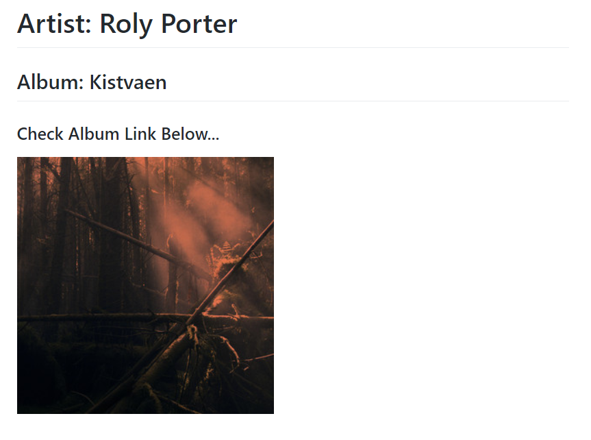

<p align="center">
<!---
  
  -->
  <h1 align="center">NowPlay-Box</h1>
  <p align="center">💿 Pinnable Dynamic Gist showing your Spotify now-playing as a Widget!</p>
</p>

> 📌✨ For more pinned-gist projects like this one, check out: https://github.com/matchai/awesome-pinned-gists

> Project hugely inspired by https://github.com/RangerDigital/neko-box

***
[](https://www.gnu.org/licenses/gpl-3.0)

**NowPlay-Box** is a simple **GitHub Action** built to make dynamic Gist displaying the album you're now-playing on **Spotify** .
<br>

## Usage
**To start, you need to prepare some things:**
- Create a new public GitHub Gist at https://gist.github.com/

- Create an Access Token with the `gist` scope and save it.
You can do that at https://github.com/settings/tokens/new

<br>

**After getting this done:**
- Fork this repository.

- Go to your fork's **Settings > Secrets** page add the following secrets:
	- **`SPOTIPY_USER_ID`** - Spotify Username
	- **`SPOTIPY_CLIENT_ID`** - Spotify client ID taken from Spotify API
	- **`SPOTIPY_CLIENT_SECRET`** - Spotify client secret taken from Spotify API
	- **`SPOTIPY_REDIRECT_URI`** - Callback URL for OAuth
	- **`SPOTIPY_REFRESH_TOKEN`** - A Spotify refresh token for your account (see below)
	- **`GH_TOKEN`** - The access token you saved earlier.
	- **`GIST_ID`** - The ID of your newly created public Gist.

   *It will look like this:*  
	 `https://gist.github.com/<username>/<hugecode>`.
<br>

**Getting a refresh token**
Run this once on your own machine, approve access in the browser, and save the printed value as the `SPOTIPY_REFRESH_TOKEN` secret:

```bash
pip install spotipy
python -c "from spotipy.oauth2 import SpotifyOAuth; from spotipy.cache_handler import MemoryCacheHandler; a=SpotifyOAuth(client_id='<id>', client_secret='<secret>', redirect_uri='<redirect uri>', scope='user-read-currently-playing', cache_handler=MemoryCacheHandler()); print(a.get_access_token(as_dict=True)['refresh_token'])"
```

Never commit the `.cache*` token files spotipy creates.

<br>

**That's It!**  
Now every 10 minutes `schedule.yml` workflow will update your Gist

<br>

<p align="center">
	
</p>

<br>

## 📃 License
This project is licensed under [GPL-3.0](https://choosealicense.com/licenses/gpl-3.0/) .
